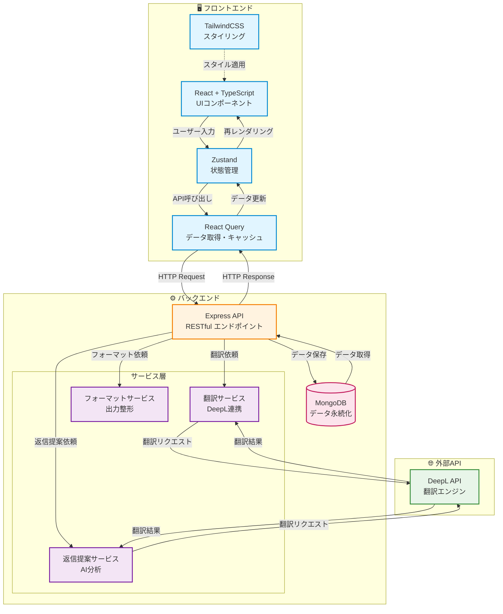

# BobでビジネスコミュニケーションをスムーズにするAI翻訳アプリを作ってみた

## はじめに

外国の社員とのメールやチャットのやり取りで、こんな悩みはありませんか？

- 翻訳ツールを使っても、ビジネスシーンに適した表現になっているか不安
- 返信内容を考えるのに時間がかかる
- 過去のやり取りを探すのが大変
- Slack/メール形式に合わせた文章を作るのが面倒

そこで、AI開発アシスタント「Bob」を使って、これらの課題を解決するビジネス翻訳アプリ「**BizTranslate**」を開発しました。

本記事では、Bobを活用した開発体験と、実装のポイントを紹介します。

## 🤖 Bobとは

**Bob**は、VS Code拡張機能として動作するAI開発アシスタントです。
- 安全性が確保されたエンタープライズ志向
- オンプレミス、クラウドなどハイブリッドな拡張性
- 全方向のモダナイゼーション
を特徴とし、開発者の皆さんのコーディング作業を支援するために設計されています。

詳細はこちらの[公式サイト](https://bob.ibm.com/)でチェック！

:::note info
**まずは無料で利用してみましょう**
Bobは30日間の無料トライアルでお試しいただくことができます。
👉 無料トライアルは[**こちら**](https://bob.ibm.com/trial)
また、本格的な利用の場合は、少額からのプランもございます。
👉 プラン詳細は[**こちら**](https://bob.ibm.com/pricing)
:::

## 🎯 BizTranslateとは

BizTranslateは、外国の社員とのコミュニケーションを円滑にするための翻訳アプリケーションです。

### 主な機能

- ✅ **高品質な翻訳**: DeepL APIを使用したビジネスニュアンスでの翻訳
- ✅ **会話管理**: やり取りをスレッド化して時系列で保存
- ✅ **AI返信提案**: メッセージ内容を分析して適切な返信を提案
- ✅ **形式変換**: Slack/メール形式に適した翻訳出力
- ✅ **履歴検索**: 過去のやり取りを検索・参照
- ✅ **トーン調整**: フォーマル/カジュアルな文体の切り替え

## 🏗️ システムアーキテクチャ



### データフローの説明

1. **ユーザー入力** → React UIコンポーネント
2. **状態管理** → Zustandでグローバル状態を更新
3. **API呼び出し** → React QueryがExpressサーバーにHTTPリクエスト
4. **翻訳処理** → 翻訳サービスがDeepL APIを呼び出し
5. **返信提案** → 返信提案サービスがメッセージを分析し、DeepL APIで翻訳
6. **フォーマット** → プラットフォーム形式（Slack/Email）に変換
7. **データ保存** → MongoDBに会話履歴を保存
8. **レスポンス** → フロントエンドに結果を返却
9. **UI更新** → Zustandの状態更新でReactコンポーネントが再レンダリング

### 技術スタック

**フロントエンド**
- React 18 + TypeScript
- Vite（ビルドツール）
- TailwindCSS（スタイリング）
- Zustand（状態管理）
- React Query（サーバーデータ管理）
- React Router（ルーティング）

**バックエンド**
- Node.js + Express
- TypeScript
- MongoDB + Mongoose
- DeepL API（翻訳エンジン）

### 主な特徴

- **🎯 コンテキスト理解**: プロジェクト全体の構造を理解し、適切なコードを提案
- **💬 自然言語での指示**: 「ログイン機能を追加して」といった自然な日本語で指示可能
- **🔧 多様なツール**: ファイル操作、コード検索、ターミナル実行など20以上のツールを活用
- **📝 複数モード**: Code、Plan、Ask、Debugなど、タスクに応じたモードを切り替え
- **🔄 反復的な開発**: 各ステップの結果を確認しながら、段階的に実装を進める

### 私ができること

1. **コード生成**: 要件から完全なアプリケーションを構築
2. **リファクタリング**: 既存コードの改善提案と実装
3. **デバッグ支援**: エラーの原因特定と修正
4. **ドキュメント作成**: README、コメント、技術文書の生成
5. **アーキテクチャ設計**: システム設計と技術選定のサポート

### 他のAIツールとの違い

- **プロジェクト全体を理解**: 単一ファイルではなく、プロジェクト全体のコンテキストで動作
- **実際にファイルを操作**: コードの提案だけでなく、実際にファイルの作成・編集を実行
- **段階的な確認**: 各ステップで結果を確認し、承認を得てから次に進む
- **複数ツールの連携**: ファイル操作、検索、ターミナル実行などを組み合わせて複雑なタスクを実行

## 💡 Bobを使った開発体験

### Bobが特に役立った場面

#### 1. プロジェクト構造の設計

最初に「外国の社員とのメール・チャットのやり取りを円滑にする翻訳アプリを作りたい」と伝えただけで、Bobが以下を提案してくれました：

- モノレポ構成（client/server分離）
- 適切なディレクトリ構造
- 必要な依存パッケージ
- 環境変数の設定

#### 2. 複雑なロジックの実装

特に「AI返信提案機能」の実装では、Bobが以下のような洗練されたコードを生成してくれました：

```typescript
// メッセージタイプを自動分析
private analyzeMessageType(message: string): string {
  const lowerMessage = message.toLowerCase();

  // 質問
  if (
    lowerMessage.includes('?') ||
    lowerMessage.match(/^(what|when|where|who|why|how|can|could|would)/i)
  ) {
    return 'question';
  }

  // 依頼・リクエスト
  if (
    lowerMessage.match(/^(please|could you|would you|can you)/i) ||
    lowerMessage.includes('request')
  ) {
    return 'request';
  }

  // 感謝
  if (lowerMessage.match(/(thank|thanks|appreciate|grateful)/i)) {
    return 'thanks';
  }

  return 'general';
}
```

このように、メッセージの内容を分析して適切な返信パターンを選択する仕組みを、自然言語での指示だけで実装できました。

#### 3. TypeScriptの型安全性

Bobは型定義も自動的に生成してくれるため、開発中の型エラーを大幅に削減できました：

```typescript
export interface Message {
  _id: string;
  threadId: string;
  text: string;
  translatedText: string;
  direction: 'incoming' | 'outgoing';
  platform: Platform;
  tone?: Tone;
  sourceLang: Language;
  targetLang: Language;
  formattedText?: string;
  suggestions?: string[];
  createdAt: Date;
}

export type Platform = 'chat' | 'email';
export type Tone = 'formal' | 'casual';
export type Language = 'en' | 'ja' | 'zh' | 'ko' | 'es' | 'fr' | 'de' | 'pt';
```

## 🔧 実装のポイント

### 1. DeepL API連携

DeepL APIを使った翻訳サービスの実装例：

```typescript
class DeepLService {
  private translator: deepl.Translator | null = null;

  async translate(
    text: string,
    targetLang: string,
    sourceLang?: string
  ): Promise<{ translatedText: string; detectedSourceLang: string }> {
    const result = await this.getTranslator().translateText(
      text,
      sourceLang as deepl.SourceLanguageCode | null ?? null,
      targetLang as deepl.TargetLanguageCode,
      {
        splitSentences: '0' as any, // 文の分割を無効化
        preserveFormatting: true,   // フォーマットを保持
      }
    );

    return {
      translatedText: result.text,
      detectedSourceLang: result.detectedSourceLang || sourceLang || 'unknown',
    };
  }
}
```

**ポイント**:
- `splitSentences: '0'`で文の分割を無効化し、元の文章構造を保持
- `preserveFormatting: true`で改行やインデントを維持
- シングルトンパターンでTranslatorインスタンスを再利用

### 2. AI返信提案の仕組み

受信メッセージを分析して、適切な返信候補を自動生成します：

```typescript
async generateSuggestions(
  incomingMessage: string,
  platform: 'chat' | 'email',
  tone: 'formal' | 'casual' = 'formal'
): Promise<string[]> {
  const suggestions: string[] = [];
  
  // メッセージタイプを分析
  const messageType = this.analyzeMessageType(incomingMessage);
  
  // タイプに応じた日本語の返信候補を生成
  switch (messageType) {
    case 'question':
      suggestions.push(...this.getQuestionResponses(tone));
      break;
    case 'request':
      suggestions.push(...this.getRequestResponses(tone));
      break;
    // ... 他のケース
  }
  
  // 日本語の提案を英語に翻訳
  const translatedSuggestions = await Promise.all(
    suggestions.map(async (suggestion) => {
      const result = await deeplService.translate(suggestion, 'en-US', 'ja');
      return result.translatedText;
    })
  );
  
  return translatedSuggestions;
}
```

**ポイント**:
- 正規表現でメッセージタイプを自動判定
- トーン（フォーマル/カジュアル）に応じた返信候補を用意
- DeepL APIで自然な英語に翻訳

### 3. Zustandによる状態管理

Reduxよりもシンプルで、TypeScriptとの相性も良いZustandを採用：

```typescript
interface AppState {
  // スレッド関連
  threads: Thread[];
  currentThread: Thread | null;
  setCurrentThread: (thread: Thread | null) => void;
  
  // UI状態
  selectedPlatform: Platform;
  selectedTone: Tone;
  sourceLang: Language;
  targetLang: Language;
  swapLanguages: () => void;
}

export const useStore = create<AppState>((set) => ({
  threads: [],
  currentThread: null,
  setCurrentThread: (thread) => set({ currentThread: thread }),
  
  selectedPlatform: 'chat',
  selectedTone: 'formal',
  sourceLang: 'en',
  targetLang: 'ja',
  
  swapLanguages: () =>
    set((state) => ({
      sourceLang: state.targetLang,
      targetLang: state.sourceLang,
    })),
}));
```

**ポイント**:
- ボイラープレートが少なく、直感的に使える
- TypeScriptの型推論が効く
- React Queryと組み合わせてサーバー状態とクライアント状態を分離

### 4. プラットフォーム別フォーマット変換

Slack/メール形式に適した出力を生成：

```typescript
class FormatterService {
  formatForPlatform(
    text: string,
    platform: 'chat' | 'email',
    tone: 'formal' | 'casual'
  ): string {
    if (platform === 'email') {
      return this.formatForEmail(text, tone);
    }
    return this.formatForChat(text, tone);
  }

  private formatForEmail(text: string, tone: 'formal' | 'casual'): string {
    const greeting = tone === 'formal' 
      ? 'Dear [Name],' 
      : 'Hi [Name],';
    const closing = tone === 'formal'
      ? 'Best regards,\n[Your Name]'
      : 'Thanks,\n[Your Name]';
    
    return `${greeting}\n\n${text}\n\n${closing}`;
  }

  private formatForChat(text: string, _tone: 'formal' | 'casual'): string {
    // チャット形式はシンプルに
    return text;
  }
}
```

## 📊 開発期間と工数

Bobを活用することで、以下の期間で開発できました：

- **設計・プロトタイプ**: 1日
- **フロントエンド実装**: 2日
- **バックエンド実装**: 2日
- **統合・テスト**: 1日

**合計: 約6日**

通常であれば2週間程度かかる規模のプロジェクトを、Bobのサポートにより大幅に短縮できました。

## 📦 ソースコードについて

本アプリケーションの完全なソースコードは、GitHubで公開しています：

### 🔗 [GitHubリポジトリはこちら](https://github.com/yourusername/biztranslate)

リポジトリには以下が含まれています：

- 📁 **完全なソースコード**: フロントエンド・バックエンドの全実装
- 📖 **詳細なREADME**: セットアップ手順、使い方、トラブルシューティング
- 🔧 **環境設定例**: `.env.example`ファイル
- 📝 **コメント付きコード**: 各機能の実装詳細

### 特に注目してほしいファイル

実装の詳細を知りたい方は、以下のファイルをご覧ください：

| ファイル | 説明 |
|---------|------|
| `server/src/services/deepl.service.ts` | DeepL API連携の実装 |
| `server/src/services/suggestion.service.ts` | AI返信提案のロジック |
| `server/src/services/formatter.service.ts` | プラットフォーム別フォーマット変換 |
| `client/src/store/useStore.ts` | Zustandによる状態管理 |
| `client/src/components/Chat/MessageInput.tsx` | メッセージ入力UIの実装 |
| `server/src/controllers/thread.controller.ts` | スレッド管理のビジネスロジック |

### クイックスタート

詳細なセットアップ手順は、[リポジトリのREADME](https://github.com/yourusername/biztranslate#readme)をご参照ください。

**必要な環境：**
- Node.js 18以上
- MongoDB 6.0以上
- DeepL API キー（無料プラン可）

**基本的な起動コマンド：**
```bash
npm install
npm run dev
```

実際に動かしてみて、コードを読みながら理解を深めることをおすすめします！

## 💭 使ってみた感想

### 良かった点

1. **開発速度の向上**: Bobが適切なコードを提案してくれるため、実装が非常にスムーズ
2. **コード品質**: TypeScriptの型定義やエラーハンドリングも適切に実装される
3. **学習効果**: Bobが生成したコードから、ベストプラクティスを学べる

### 改善の余地

1. **UI/UXデザイン**: デザインの細かい調整は人間の判断が必要
2. **ビジネスロジック**: ドメイン固有の要件は詳細な指示が必要
3. **パフォーマンス最適化**: 大規模データの処理は追加のチューニングが必要

## 🔮 今後の拡張予定

- [ ] 音声入力機能
- [ ] リアルタイム翻訳（WebSocket）
- [ ] チーム機能（複数ユーザー対応）
- [ ] Slack/メール直接連携
- [ ] モバイルアプリ版
- [ ] 多言語対応の拡充

## まとめ

BobというAI開発アシスタントを活用することで、以下のメリットを実感できました：

1. **開発時間の大幅な短縮**: 通常2週間の作業を6日で完了
2. **高品質なコード**: TypeScript、エラーハンドリング、ベストプラクティスを自動適用
3. **学習機会**: 生成されたコードから新しい技術やパターンを学べる

特に、複雑なロジック（AI返信提案、メッセージ分析など）の実装において、Bobの提案が非常に的確でした。

ビジネスコミュニケーションの効率化という実用的な課題を、最新のAI技術を活用して解決できたことは、大きな成果だと感じています。

皆さんもBobを使って、アイデアを素早く形にしてみてはいかがでしょうか？

## 🔗 リンク集

### プロジェクト

- **[GitHubリポジトリ](https://github.com/yourusername/biztranslate)** ⭐ スターをいただけると嬉しいです！
  - 完全なソースコード
  - 詳細なREADME
  - セットアップガイド

### 使用技術

- [DeepL API](https://www.deepl.com/pro-api) - 高品質な翻訳API
- [React](https://react.dev/) - UIフレームワーク
- [Zustand](https://github.com/pmndrs/zustand) - 状態管理ライブラリ
- [TailwindCSS](https://tailwindcss.com/) - CSSフレームワーク
- [MongoDB](https://www.mongodb.com/) - NoSQLデータベース
- [Express](https://expressjs.com/) - Node.jsフレームワーク

---

**この記事が参考になりましたら、LGTMやストックをいただけると嬉しいです！**

実際にコードを見て、動かして、改善のアイデアがあればぜひPull Requestをお待ちしています 🚀

質問やフィードバックもお気軽にコメントください。